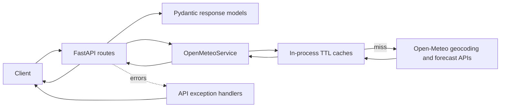

# Weather Digest API

A lightweight asynchronous REST API for current weather, short-range forecasts,
and concise multi-city weather digests. The service geocodes city names and
retrieves weather data from [Open-Meteo](https://open-meteo.com/), then returns
validated JSON responses through FastAPI.

## Features

- Current conditions for a city.
- Daily forecasts for 1–7 days.
- Concurrent digests for up to five cities, with a readable summary for each.
- A mobile-first frontend for forecasts and multi-city weather comparisons.
- In-memory TTL caching for geocoding and weather lookups.
- `X-Cache: HIT` / `X-Cache: MISS` response headers.
- Consistent JSON errors and a single retry for transient provider failures.
- Interactive API documentation at `/docs` and `/redoc`.

## Tech stack

| Area | Technology |
| --- | --- |
| API framework | FastAPI |
| Data validation | Pydantic |
| Async HTTP client | HTTPX |
| Weather provider | Open-Meteo |
| Cache | `cachetools.TTLCache` |
| ASGI server | Uvicorn |
| Web frontend | React, TypeScript, Vite, Tailwind CSS, TanStack Query, Recharts |
| Integration tests | pytest, FastAPI `TestClient`, respx |
| Linting and CI | Ruff, GitHub Actions |

## Architecture



Each application lifespan creates one shared `OpenMeteoService` and HTTPX
client. The service resolves city names, fetches provider data on cache misses,
and maps responses into the public schemas. The digest endpoint uses concurrent
requests for the requested cities.

## Quick start

Python 3.11 or newer is recommended.

### Local development

Create and activate a virtual environment:

```powershell
py -3.11 -m venv .venv
.\.venv\Scripts\Activate.ps1
```

On macOS or Linux:

```bash
python3.11 -m venv .venv
source .venv/bin/activate
```

Install the application dependencies and start the development server:

```bash
python -m pip install -r requirements.txt
python -m uvicorn app.main:app --reload
```

The API is available at <http://localhost:8000>. Interactive documentation is
at <http://localhost:8000/docs>.

## Frontend

The frontend is a React + TypeScript single-page app built with Vite and
Tailwind CSS. It uses TanStack Query for API requests, Recharts for forecast
charts, and lucide-react for icons.

### Development workflow

Use two terminals from the repository root.

Terminal 1 — start the API:

```powershell
python -m uvicorn app.main:app --reload
```

Terminal 2 — install frontend dependencies and start Vite:

```powershell
cd frontend
npm ci
npm run dev
```

Open the frontend URL printed by Vite (usually <http://localhost:5173>).
Vite proxies `/weather`, `/digest`, and `/health` requests to the API at
`http://127.0.0.1:8000`.

### Production build

Build the static frontend bundle:

```powershell
cd frontend
npm ci
npm run build
```

When `frontend/dist` exists, FastAPI serves the app at `/`, its generated files
from `/assets`, and the SPA entry point for unknown non-API routes. To serve the
built app locally, start Uvicorn from the repository root after building.
Docker Compose builds the frontend and API image together, then serves both at
<http://localhost:8000>:

```powershell
docker compose up --build
```

### Screenshot

> Screenshot placeholder: add `docs/weather-digest-screenshot.png` and replace
> this note with the image.

### Docker Compose

Build and start the API:

```bash
docker compose up --build
```

Open <http://localhost:8000>, or stop the service with:

```bash
docker compose down
```

The image uses a Node stage for the frontend and Python slim stages for the
API. The runtime runs Uvicorn as a non-root user.

## Configuration

Settings can be provided through environment variables. The prefix is
`WEATHER_DIGEST_`; a local `.env` file is also supported.

| Variable | Default | Description |
| --- | --- | --- |
| `WEATHER_DIGEST_CACHE_TTL_SECONDS` | `300` | Cache lifetime in seconds. Set to `0` to disable cache storage. |
| `WEATHER_DIGEST_OPEN_METEO_FORECAST_BASE_URL` | `https://api.open-meteo.com/v1/forecast` | Open-Meteo forecast endpoint. |
| `WEATHER_DIGEST_OPEN_METEO_GEOCODING_BASE_URL` | `https://geocoding-api.open-meteo.com/v1/search` | Open-Meteo geocoding endpoint. |

For example, to use a ten-minute cache:

```powershell
$env:WEATHER_DIGEST_CACHE_TTL_SECONDS = "600"
```

```bash
export WEATHER_DIGEST_CACHE_TTL_SECONDS=600
```

## API endpoints

All weather endpoints require a city name with at least two characters.

| Method | Path | Query parameters | Description |
| --- | --- | --- | --- |
| `GET` | `/weather/current` | `city` (required) | Current conditions for one city. |
| `GET` | `/weather/forecast` | `city` (required), `days` (1–7, default `7`) | Current conditions and daily forecast. |
| `GET` | `/digest` | `cities` (required, comma-separated, up to 5) | Concurrent current-weather summaries for multiple cities. |
| `GET` | `/` | — | Frontend when built, otherwise service name and health/docs links. |
| `GET` | `/health` | — | Health check. |

### Current weather

```bash
curl "http://localhost:8000/weather/current?city=Tunis"
```

```json
{
  "time": "2026-11-25T20:15:00",
  "temperature_c": 24.0,
  "wind_speed_kmh": 8.4,
  "weather_code": 0
}
```

### Forecast

```bash
curl "http://localhost:8000/weather/forecast?city=Tunis&days=1"
```

```json
{
  "city": "Tunis, Tunisia",
  "latitude": 36.8,
  "longitude": 10.2,
  "timezone": "Africa/Tunis",
  "current": {
    "time": "2026-11-25T20:15:00",
    "temperature_c": 24.0,
    "wind_speed_kmh": 8.4,
    "weather_code": 0
  },
  "daily": [
    {
      "date": "2026-11-25",
      "temperature_max_c": 25.0,
      "temperature_min_c": 18.0,
      "precipitation_sum_mm": 0.0,
      "precipitation_probability_max_percent": 10.0,
      "weather_code": 0,
      "wind_speed_max_kmh": 12.0
    }
  ]
}
```

The forecast response includes one item in `daily` per requested forecast day.

### Multi-city digest

```bash
curl "http://localhost:8000/digest?cities=Tunis,Paris"
```

```json
[
  {
    "city": "Tunis, Tunisia",
    "latitude": 36.8,
    "longitude": 10.2,
    "current": {
      "time": "2026-11-25T20:15:00",
      "temperature_c": 24.0,
      "wind_speed_kmh": 8.4,
      "weather_code": 0
    },
    "rain_chance_percent": 10.0,
    "summary": "Sunny, 24°C, rain chance 10%"
  },
  {
    "city": "Paris, France",
    "latitude": 48.9,
    "longitude": 2.3,
    "current": {
      "time": "2026-11-25T20:15:00",
      "temperature_c": 24.0,
      "wind_speed_kmh": 8.4,
      "weather_code": 0
    },
    "rain_chance_percent": 10.0,
    "summary": "Sunny, 24°C, rain chance 10%"
  }
]
```

### Errors

Errors use a consistent JSON shape:

```json
{
  "error": "City not found",
  "detail": "No location found for 'Atlantis'"
}
```

| Status | Meaning |
| --- | --- |
| `404` | The requested city could not be geocoded. |
| `422` | Query parameters are invalid, such as a forecast outside 1–7 days or more than five digest cities. |
| `502` | The upstream weather provider failed or returned invalid data. |
| `504` | The upstream request timed out after its retry. |

Transient upstream request failures are retried once. HTTPX uses a 10-second
default phase timeout and a 5-second connection timeout.

## Caching

Geocoding, current-weather, and forecast lookups use in-process
`cachetools.TTLCache` instances. The default TTL is 300 seconds (five minutes),
configured with `WEATHER_DIGEST_CACHE_TTL_SECONDS`; setting it to `0` disables
cache storage. Each cache holds up to 256 entries.

Weather responses include an `X-Cache` header. It is `HIT` only when every
lookup required by that request was served from cache; otherwise it is `MISS`.
For example, a request may be `MISS` when its city is cached but its requested
forecast length is not.

This cache reduces repeated provider calls without adding a service dependency,
but it is local to one application process and is cleared on restart. Separate
workers do not share entries. Redis could provide a shared cache and centralized
invalidation, with additional operational complexity and network overhead.

## Running tests

Install development dependencies and run the test suite:

```bash
python -m pip install -r requirements-dev.txt
pytest
```

Run Ruff separately:

```bash
ruff check app tests
```

The integration tests use FastAPI `TestClient` and respx to mock Open-Meteo;
they do not require live provider access. GitHub Actions runs Ruff and pytest
on pushes and pull requests using Python 3.11.

## Project structure

```text
.
├── app/
│   ├── main.py                 # FastAPI app, lifespan, and exception handlers
│   ├── config.py               # Environment-backed settings
│   ├── exceptions.py           # Public API exception types
│   ├── schemas.py              # Validated response models
│   ├── routers/
│   │   └── weather.py          # Weather and digest endpoints
│   └── services/
│       ├── cache.py            # Async TTL cache and request cache tracking
│       └── open_meteo.py       # Geocoding and weather-provider client
├── tests/
│   ├── conftest.py             # Shared TestClient and respx fixtures
│   ├── test_api_respx.py       # Mocked API integration tests
│   ├── test_open_meteo.py      # Provider-service tests
│   └── test_weather_routes.py  # Route validation and behavior tests
├── .github/workflows/ci.yml    # Frontend build/lint, Ruff, and pytest CI
├── Dockerfile
├── docker-compose.yml
├── requirements.txt
└── requirements-dev.txt
```

## Future improvements

- Use Redis for shared cache entries in multi-worker or multi-instance
  deployments.
- Add rate limiting and API authentication if the service is exposed publicly.
- Add metrics, tracing, and structured logs for provider latency and cache hit
  rates.
- Add provider circuit breaking and configurable retry backoff.
